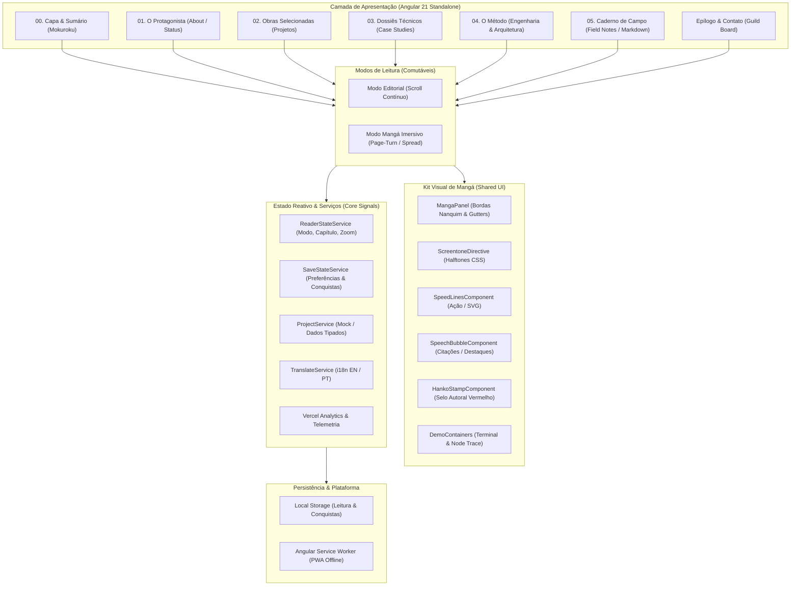

# Especificação Funcional e Arquitetura do Portfólio

> **Status:** Aprovado para Planejamento de Implementação  
> **Versão:** 1.0.0  
> **Autor:** Engenharia de Software Sênior  
> **Base de Código:** Angular 21 (Zoneless, Signals) — `erickg.dev`  
> **Conceito:** Mangá Digital Editorial — *A Trajetória de um Engenheiro de Software*

---

## 1. Visão Geral e Conceito Artístico-Editorial

O portfólio digital `erickg.dev` transforma a apresentação da trajetória profissional de **Erick Gabriel** em uma publicação editorial no formato de mangá digital contemporâneo.

### 1.1 Princípios de Design e Identidade
- **Paleta Estritamente Editorial:**
  - **Preto Nanquim (`#0D0D0D` / `#1A1A1A`):** Tinta de impressão densa, traços firmes, bordas de quadros e tipografia principal.
  - **Branco Papel Mangá (`#F7F7F5`):** Textura base com brilho suavizado para evitar fadiga ocular em leituras prolongadas.
  - **Tons de Retícula / Halftone (`#333333` a `#B0B0B0`):** Padrões de pontos (*screentone*) gerados via gradientes CSS para sombreamentos, texturas e atmosfera técnica.
  - **Acento Vermelho Nanquim / Hanko (`#D62828`):** Realces dramáticos, carimbos autorais, avisos de erro, status ativo e botões de ação primários.
- **Linguagem Gráfica de Mangá:**
  - Enquadramentos assimétricos e dinâmicos com sarjetas (*gutters*) estruturadas.
  - Balões de diálogo para declarações e depoimentos técnicos.
  - Linhas de velocidade (*speed lines*) sutis em SVGs leves para destacar marcos de performance.
  - Carimbo *Hanko* ("ERICK / 江里克") como assinatura autoral de commits e entregas.
- **Isenção Estrita de Propriedade Intelectual de Terceiros:**
  - O projeto adota a gramática, a composição e a estética editorial tradicional de mangás, sem utilizar personagens, silhuetas, logotipos ou universos pertencentes a franquias comerciais (sem referências explícitas a Shonen Jump, Toei, etc.).

---

## 2. Diagrama da Arquitetura Funcional

---

## 3. Especificação dos Requisitos Funcionais

### RF-01: Capa do Portfólio (Frontispiece / Cover)
- **Descrição:** Apresentação de abertura no formato de capa de volume de mangá publicado (`Volume 01: The Full-Stack Chronicles`).
- **Elementos Visuais:**
  - Título estilizado em tipografia editorial forte: `ERICK GABRIEL // SOFTWARE ENGINEER`.
  - Número do Volume (`VOL. 01 — RUNTIME EDITION`).
  - Ilustração central autoral em estilo nanquim/SVG vetorial leve.
  - Carimbo *Hanko* vermelho no rodapé garantindo a chancela de publicação autoral.
  - Indicador de última compilação estável (`Build: v21.x // Master Branch`).
- **Comportamento:**
  - Carregamento instantâneo sem telas pretas de atraso forçado.
  - Botão de ação direta: `[ ABRIR VOLUME ]` que conduz suavemente para o Sumário ou Capítulo 01.

### RF-02: Entrada na Experiência e Transição Suave
- **Descrição:** Eliminação da antiga tela de boot com delay artificial de 3.5 segundos em favor de uma transição editorial fluida ("Abrir Capa").
- **Comportamento:**
  - O usuário visualiza imediatamente a capa e pode rolar ou clicar para entrar.
  - Animação de transição baseada em abertura de cortina editorial ou virada da capa para revelar o Sumário (*Mokuroku*).
  - Estado salvo em `sessionStorage`: caso o usuário recarregue a página na mesma sessão, ele retorna diretamente ao capítulo onde estava, sem reexibição da capa.

### RF-03: Modo Editorial com Rolagem Convencional (Scroll Padrão)
- **Descrição:** Experiência padrão de leitura baseada no fluxo vertical natural da web (estilo *webtoon* refinado para layouts de revista).
- **Comportamento:**
  - Cada capítulo flui verticalmente com sarjetas pretas e brancas delimitando os painéis.
  - Elementos dispostos com diagramação assimétrica e quebras de página visuais.
  - Indicador flutuante de progresso de leitura (*Reading Progress Bar*) estilizado como linha de nanquim no topo.
  - Ideal para recrutadores e leitura rápida em dispositivos móveis.

### RF-04: Modo de Leitura Imersiva (Page-Turn / Spread View)
- **Descrição:** Modo comutável que transforma o portfólio em um leitor de mangá digital com virada de páginas animada.
- **Comportamento:**
  - **Desktop Widescreen:** Exibição em folha dupla (*Spread View* — página esquerda e direita lado a lado).
  - **Mobile / Telas Estreitas:** Exibição em página única (*Single Page View*).
  - **Interação:** Suporte a setas do teclado (← / →), botões virtuais de virada na barra inferior e gestos de arrasto (*swipe* touch).
  - **Sentido de Navegação Opcional:** Suporte a sentido de leitura tradicional ocidental (padrão) e alternador para sentido oriental (direita para esquerda) acessível na barra de leitura.
  - **Regra Fundamental de Acessibilidade:** O modo imersivo é 100% opcional; nenhum conteúdo é exclusivo dele e a qualquer instante o leitor pode retornar ao modo de rolagem com 1 clique.

### RF-05: Navegação Entre Capítulos (Table of Contents / Mokuroku)
- **Estrutura de Capítulos:**
  - `Capítulo 00`: **Frontispício & Sumário** (`/`)
  - `Capítulo 01`: **O Protagonista** (`/about` ou `/chapter/01`)
  - `Capítulo 02`: **Arsenal Selecionado** (`/projects` ou `/chapter/02`)
  - `Capítulo 03`: **Dossiês de Engenharia** (`/cases` ou `/chapter/03`)
  - `Capítulo 04`: **O Método de Arquitetura** (`/methods` ou `/chapter/04`)
  - `Capítulo 05`: **Caderno de Campo** (`/log` ou `/chapter/05`)
  - `Epílogo`: **Transmissão & Alianças** (`/contact` ou `/epilogue`)
- **Comportamento de Navegação:**
  - Menu retrátil estilizado como fita marcadora de páginas (*shiori* / bookmark).
  - Cada capítulo possui URL profunda acessível (`Deep Linking`) preservando a indexação e compartilhamento direto.

### RF-06: Seção de Projetos Selecionados
- **Descrição:** Apresentação dos 4 projetos autorais de Erick Gabriel em painéis assimétricos dinâmicos:
  1. **The Architect's Forge (`ng-architect-cli`):** Painel focado em arquitetura e ferramentas CLI para ecossistema Angular.
  2. **Cyber Sleuth Toolkit (`devkit_forense`):** Painel dramático com estética de investigação e perícia cibernética em Python/Docker.
  3. **Network Guardian Node (`ngx-smart-interceptor`):** Painel temático de escudo e defesa de requisições HTTP e resiliência com RxJS.
  4. **Otaku Courier Network (`anime-newsletter`):** Painel editorial conectado ao universo de animes e comunicação via nuvem.
- **Metadados dos Cards:**
  - Título, tags de tecnologias com estilo de carimbo de retícula, sumário de valor de engenharia e link de acesso direto validado (corrigindo o bug anterior de `link` vs `url`).

### RF-07: Estudos de Caso Detalhados (Deep-Dive Dossiers)
- **Descrição:** Gaveta técnica ou página expandida acessível a partir de cada projeto selecionado, estruturada como uma sequência de quadros explicativos:
  - **Quadro 1: O Desafio / O Problema:** O contexto de negócio ou gargalo técnico inicial.
  - **Quadro 2: O Esquema de Arquitetura:** Diagrama técnico em nanquim/SVG demonstrando a solução.
  - **Quadro 3: O Ponto Crítico de Código:** Trecho de código TypeScript/Python destacado com sintaxe P&B contrastada.
  - **Quadro 4: O Desfecho & Métricas:** Resultados aferidos (ex: redução de bundle de 45%, tempo de build, resiliência a falhas).
- **Comportamento:** Acesso direto via botão `[ LER DOSSIÊ COMPLETO ]`, sem descarregar a página principal.

### RF-08: Seção de Processo de Engenharia (The Blueprint)
- **Descrição:** Exposição do método de trabalho de Erick Gabriel como engenheiro de software:
  - *Filosofia:* Domínio de arquiteturas desacopladas, tipagem rigorosa, estado derivado com Signals e padrões funcionais.
  - *Fluxo de Entrega:* Modelagem de Domínio → Testes com Jest (TDD / Proteção de Regras) → Pipeline de CI com GitHub Actions → Deploy e Monitoramento com Vercel Analytics.
  - *Visualização:* Fluxograma estilizado em painéis sequenciais de quadrinhos simulando as etapas de uma esteira de entrega contínua de software.

### RF-09: Field Notes (Caderno de Campo & Aprendizados)
- **Descrição:** Espaço editorial para publicação de experimentos, boas práticas, notas técnicas e lições aprendidas ao longo da carreira.
- **Comportamento:**
  - Reutilização do motor [`ngx-markdown`](file:///C:/Users/erick.alves/Documents/GitHub/erickg.dev/package.json#L28) para renderizar artigos e notas a partir de arquivos `.md` locais (`src/assets/notes/*.md`).
  - Renderização personalizada de títulos, blocos de código com fundo nanquim escuro e caixas de nota com balões de aviso.

### RF-10: Página / Seção Sobre o Autor (Ficha de Personagem)
- **Descrição:** Perfil biográfico e profissional de Erick Gabriel apresentado como a ficha técnica de um protagonista:
  - *Dados Pessoais:* Engenheiro de Software Full-Stack, foco em Frontend Moderno (Angular Zoneless, RxJS, TypeScript) e Backend Resiliente (.NET, Python, Node.js).
  - *Trajetória de Evolução:* Resumo cronológico das transições de carreira (2022-2024 até presente).
  - *Atributos & Habilidades:* Barras técnicas com preenchimento em blocos de retícula (Halftone Blocks) substituindo a antiga barra de jogos colorida por estética monocromática técnica.

### RF-11: Contato e Links Profissionais (Mural de Transmissão)
- **Descrição:** Canal de comunicação direta com o autor.
- **Componentes:**
  - Formulário com campos de texto de alta legibilidade, bordas de 2px nanquim e foco com contorno vermelho vivo.
  - Cartões de ação rápida para conexões externas:
    - LinkedIn: `https://www.linkedin.com/in/erickgdev/`
    - GitHub: `https://github.com/ErickG123`
    - Dev.to: `https://dev.to/erickg123`
    - E-mail profissional.

### RF-12: Tratamento de Imagens Ausentes e Telas de Erro (404)
- **Descrição:** Sistema de resiliência visual contra falhas de rede ou carregamento de mídia:
  - Caso uma imagem demore ou falhe, ela é substituída automaticamente por uma moldura em retícula CSS com mensagem editorial: `[ PAINEL EM PROCESSO DE ENTINTAMENTO ]`.
  - Página 404 customizada: *Capítulo Inexistente* — ilustração autoral de um painel rasgado convidando o leitor a retornar ao Sumário.

### RF-13: Comportamento Responsivo e Breakpoints
- **Grid Adaptativo de Mangá:**
  - **Desktop Ultra-Wide / Widescreen (> 1200px):** Layout editorial de página dupla ou grid de 3 a 4 colunas com sarjetas largas e painéis hero proeminentes.
  - **Desktop / Laptop (768px a 1199px):** Layout de 2 colunas com proporções balanceadas e painéis de leitura confortáveis.
  - **Mobile (< 768px):** Transição automática para pilha vertical de coluna única; botões de navegação migram para a barra inferior fixa (*Bottom Action Bar*) de fácil alcance com o polegar.

### RF-14: Acessibilidade (a11y) e Suporte a Movimento Reduzido
- **Conformidade WCAG 2.1 AA:**
  - Contraste de texto mínimo de 4.5:1 em todos os parágrafos e 3:1 em títulos.
  - Tipografia de leitura: Textos longos, parágrafos e descrições usam fontes sans-serif do sistema limpas e legíveis (`font-size >= 15px`, `line-height >= 1.6`); a tipografia expressiva de mangá fica restrita a títulos, onomatopeias e balões curtos.
- **`prefers-reduced-motion`:**
  - Ao detectar a preferência de movimento reduzido no sistema operacional, todas as animações 3D de virada de página, linhas de velocidade flutuantes e efeitos de digitação são desativados, substituindo-os por transições de opacidade instantâneas ou fixas.
- **Navegação por Teclado e Foco:**
  - Todos os links, botões e capítulos possuem foco visível (`:focus-visible`) com contorno duplo em nanquim e vermelho.
  - Atributos semânticos `aria-label`, `aria-expanded` e tags estruturais (`<main>`, `<article>`, `<nav>`, `<aside>`).

---

## 4. Regras de Arquitetura e Decisões Técnicas

| Decisão Arquitetural | Justificativa Técnica |
| :--- | :--- |
| **Manter Angular 21 Standalone + Zoneless** | Aproveita o excelente tempo de inicialização e bundle leve já aferido na auditoria (~105 kB transferidos), garantindo performance exemplar sem overhead de Zone.js em produção. |
| **Isolar Conteúdo Editorial em Types Estritos** | O conteúdo de projetos, dossiês e capítulos deve residir em módulos de dados puros (`core/data/`), desacoplados dos componentes de template. Facilita manutenibilidade e suporte futuro a CMS ou API sem refatorar a UI. |
| **CSS Puro para Retículas (Halftones)** | Uso de `radial-gradient` matemático do CSS em vez de imagens PNG repetitivas de retícula. Zera requisições HTTP adicionais e escala perfeitamente em telas Retina/4K. |
| **Componente de Leitor Desacoplado do Conteúdo** | Os componentes de conteúdo (`Chapter01Component`, `ProjectsComponent`) não devem saber se estão no modo de rolagem ou no modo de virada de página. Eles apenas emitem painéis que o container orquestra. |
| **Preservar URLs e Roteamento Angular** | Cada seção é indexável e navegável por URL canônica (`/about`, `/projects`, etc.), garantindo que recrutadores possam enviar links diretos para projetos específicos sem exigir navegação sequencial da capa. |
| **Suporte Opcional a Efeitos Sonoros / BGM** | A trilha sonora retro `bgm.mp3` e o controle de áudio já existentes são mantidos como opcional desativado por padrão (*opt-in*), respeitando as políticas de autoplay dos navegadores. |

---

## 5. Lista Ordenada de Requisitos e Dependências Técnicas

A implementação deve seguir rigorosamente a sequência de dependências abaixo para evitar retrabalho:

1. **Correções de Fundação e Saneamento do Modelo:**
   - Excluir o arquivo redundante [`src/app/features/projects/models/project.model.ts`](file:///C:/Users/erick.alves/Documents/GitHub/erickg.dev/src/app/features/projects/models/project.model.ts).
   - Consolidar a interface mestre [`Project`](file:///C:/Users/erick.alves/Documents/GitHub/erickg.dev/src/app/core/models/project.interface.ts) garantindo a propriedade canônica `url` e ajustando os componentes consumidores.
   - Limpar referências mortas ao PrimeNG no [`ThemeService`](file:///C:/Users/erick.alves/Documents/GitHub/erickg.dev/src/app/core/theme.service.ts).

2. **Criação do Design System Editorial de Mangá (SCSS Tokens & Utilitários):**
   - Definir variáveis globais de cores: `--manga-ink`, `--manga-paper`, `--manga-screentone`, `--manga-accent-red`.
   - Implementar classes utilitárias de moldura de quadrinho (`.manga-panel`, `.gutter-sm`, `.gutter-md`, `.screentone-dot`).
   - Ajustar tipografia com foco duplo: display dramático para títulos e sans-serif ultra-legível para corpos de texto.

3. **Criação dos Componentes de UI Compartilhados (`shared/components/manga-ui/`):**
   - `MangaPanelComponent`: Container com borda nanquim, suporte a tags e enquadramento.
   - `SpeechBubbleComponent`: Balão de diálogo editorial com cauda direcional.
   - `HankoStampComponent`: Selo visual vermelho de autenticação do autor.
   - `ReadingProgressComponent`: Barra de progresso de leitura em estilo traço de pincel.

4. **Implementação do Orquestrador de Leitura (`ReaderStateService`):**
   - Gerenciamento reativo via Signals dos modos `editorial-scroll` vs `manga-reader`.
   - Detecção e respeito imediato a `prefers-reduced-motion`.

5. **Refatoração das Features em Capítulos:**
   - **Capítulo 00:** Capa editorial de mangá e Sumário interativo.
   - **Capítulo 01:** Status e perfil profissional de Erick Gabriel.
   - **Capítulo 02:** Vitrine assimétrica dos 4 projetos oficiais com links corrigidos.
   - **Capítulo 03:** Dossiês técnicos com narrativa em 4 quadros (Desafio, Arquitetura, Código, Impacto).
   - **Capítulo 04:** Blueprint de engenharia e pipelines.
   - **Capítulo 05:** Caderno de campo com leitor Markdown estilizado.
   - **Epílogo:** Mural de contato e conexões sociais.

6. **Validação, Testes e Cobertura:**
   - Atualizar e expandir as suítes de testes unitários com Jest para cobrir os novos estados do `ReaderStateService` e os novos componentes.
   - Garantir aprovação de 100% dos testes (`npm run test:ci`) e geração de build de produção sem quebra de orçamentos (`npm run build`).
